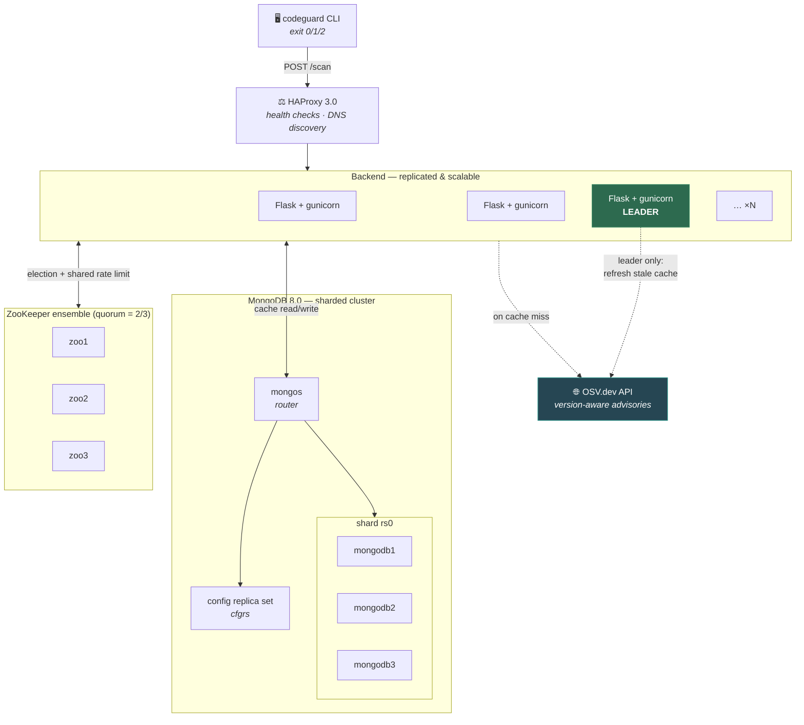
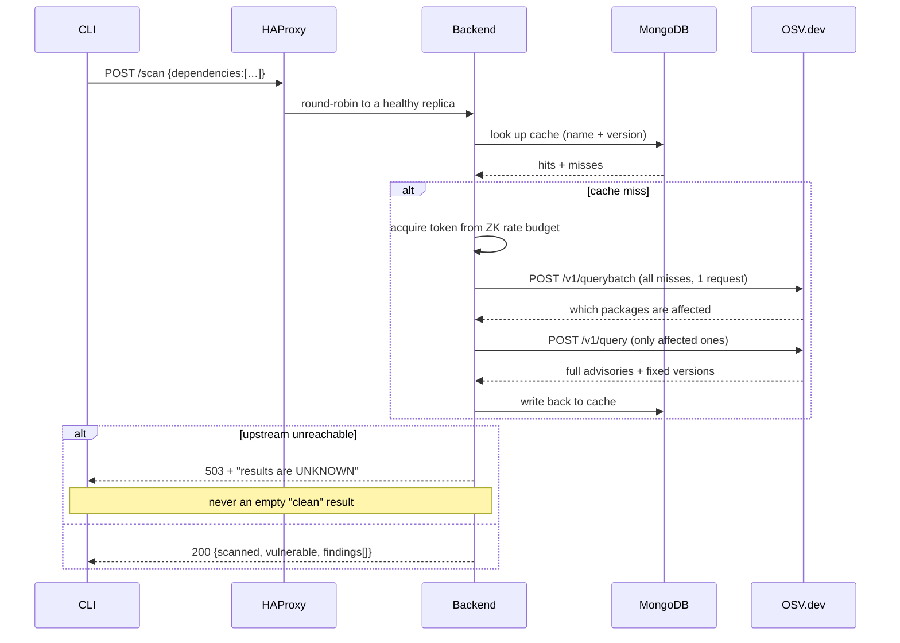
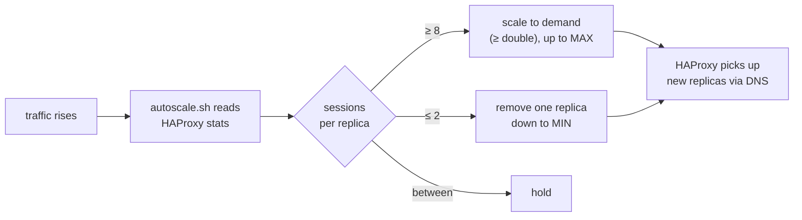

# 🛡️ codeguard

[](https://github.com/Naor-Yekutiely/codeguard/actions/workflows/ci.yml)


A distributed vulnerability scanner for Python dependencies. Point it at a
repository and it tells you which packages have known CVEs, how bad they are,
and which version fixes them.

Originally a Ruppin distributed-systems final project; **v2** rebuilt the
scanning core, the coordination layer and the deployment.

<p align="center">
  
</p>

---

## Quick start

Requires Docker, Docker Compose, `jq`, and optionally `pipreqs`.

```bash
git clone https://github.com/Naor-Yekutiely/codeguard.git && cd codeguard
./install.sh
```

The installer checks prerequisites, generates random credentials into `.env`,
builds and starts the cluster, runs a smoke scan, and installs the CLI. Then:

```bash
cd /path/to/your/project && codeguard
```

The cluster builds itself in about 45 seconds from nothing: replica sets are
initiated, the shard is registered and the collection is sharded automatically.
Nothing has to be run by hand.

It starts with **one backend replica** and grows only when load arrives — see
[Scaling](#scaling).

**Exit codes** — this is what makes it usable in a pipeline:

| Code | Meaning |
|:----:|---------|
| `0`  | Scanned successfully, nothing found |
| `1`  | Vulnerabilities found |
| `2`  | Scan could not complete — results are **unknown**, not clean |

```bash
codeguard -j > report.json   # raw JSON for pipelines
codeguard -s flask==2.2.2    # single package
```

---

## Architecture



**Three roles, deliberately separate:**

| Component | Job |
|-----------|-----|
| **HAProxy** | Spreads *request traffic* across replicas, ejects unhealthy ones |
| **ZooKeeper** | Decides *who owns the single-writer work* (cache refresh, rate budget) |
| **MongoDB** | Stores the vulnerability cache, sharded on a hashed `_id` |

Load balancing and leader election solve different problems — that is why both
exist here, and why neither replaces the other.

---

## How a scan works



### Why OSV.dev, not the NVD keyword search

| | NVD `keywordSearch` | **OSV.dev** |
|---|---|---|
| Version aware | ❌ matches CVE *text* | ✅ matches affected version ranges |
| Batching | ❌ 1 request per package | ✅ whole scan in one request |
| Rate limit | 5 req / 30s without a key | no key required |
| Sources | NVD only | 20+ feeds incl. GitHub Advisories, PyPI |

Searching NVD for `requests` returns every advisory whose description contains
the word "requests". OSV answers the question that actually matters: *is this
version affected, and what fixes it.* NVD remains available as an opt-in
fallback (`NVD_FALLBACK_ENABLED=true`) and its results are flagged
`version_aware: false`.

---

## Scaling

The backend is a **replicated service**, not four hardcoded ones. It starts at
**1 replica** — idle capacity is pure cost — and grows on demand. HAProxy finds
replicas over Docker DNS (`server-template` + `resolvers`), so scaling needs no
config change and no restart:

```bash
docker compose up -d --no-recreate --scale backend=8 backend   # manual
docker compose --profile autoscale up -d                        # automatic
```

New replicas join the ZooKeeper election automatically and start serving within
about 5 seconds — the DNS hold interval.

<p align="center">
  
</p>

Measured on a 40-connection load test, starting from one replica:

| t | replicas | what the autoscaler saw |
|---|---|---|
| 0s | 1 | idle |
| 10s | **5** | 40 sessions ÷ 8 per replica → jump straight to 5 |
| 20s | **8** | still saturated → up to `MAX_REPLICAS` |
| load ends | 8 | held through the spike |
| +84s | **1** | drained one replica at a time back to `MIN_REPLICAS` |

Scale-up is demand-driven (it computes the replicas the load actually needs, so
a spike does not have to climb 1→2→4→8 across several cooldowns). Scale-down is
deliberately gradual, to avoid flapping.



### Autoscaling

Docker Compose describes a *fixed* topology — it has no notion of "add capacity
when busy". `scripts/autoscale.sh` closes that gap by watching HAProxy's own
statistics and calling `docker compose up --scale`. Run it as a container:

```bash
docker compose --profile autoscale up -d
docker logs -f codeguard_autoscaler
```

…or directly on the host:

```bash
MIN_REPLICAS=1 MAX_REPLICAS=12 ./scripts/autoscale.sh
./scripts/autoscale.sh --once      # evaluate once, for cron
```

| Knob | Default | Meaning |
|---|:--:|---|
| `MIN_REPLICAS` | `1` | Never scale below this |
| `MAX_REPLICAS` | `12` | Never scale above this |
| `SCALE_UP_AT` | `8` | Sessions per replica that trigger growth |
| `SCALE_DOWN_AT` | `2` | Sessions per replica that trigger shrink |
| `AUTOSCALE_COOLDOWN` | `60s` | Minimum gap between scaling actions |

> **In production**, use a Kubernetes `HorizontalPodAutoscaler` or Nomad
> instead. They run the same control loop with proper metrics, cooldowns and
> scheduling. This script exists because Compose has no such primitive, and it
> keeps the mechanism visible rather than hidden behind a platform.

---

## Why ZooKeeper — and why the leader has a real job

Every replica can serve scans. Exactly **one** may refresh the shared cache: if
all of them refreshed independently you would get N× the upstream calls and
racing writes. Leadership here means precisely one thing:

```python
# refresh.py — the elected leader, and only the leader, runs this
while not stop_event.wait(REFRESH_INTERVAL_SECONDS):
    refresh_once(scanner)          # re-fetch cache entries older than the TTL
```

ZooKeeper also holds the **shared outbound rate budget**. Upstream APIs throttle
per source IP, not per container, so a per-process limiter would let N replicas
exceed the agreed rate N times over. The budget is a token bucket in a znode,
updated with version-checked (compare-and-swap) writes.

Leadership is observable:

```bash
curl -s localhost:80/health | jq '{node, leader, zookeeper, refresh}'
```

<details>
<summary><b>Historical note — v1 had ZooKeeper and removed it</b></summary>

ZooKeeper was in this project from Nov 2022 until commit `7922282`
(*"remove ZK & Configure HAProxy LB"*, Jan 2023). Removing it was the right
call at the time — but not for the reason it looked like.

Digging through the history, the v1 integration **never actually ran**:

- `enableZooKeeper` was added as `False` and removed as `False` — never once
  set to `True` in any commit on any branch
- `signal.signal(SIGINT, self.handler(le))` *called* the handler instead of
  registering it, and the handler signature was missing `self` — the process
  would have crashed on startup
- the client connected to `localhost:2181` while the container was named `zoo`
- the ensemble had a single node, so there was no quorum to lose
- **nothing ever consumed `is_leader()`** — the election ran and then every
  replica behaved identically

So v1 had leader election with no leader job. v2 reintroduces it with one.
</details>

---

## Security

| Control | Status |
|---|---|
| MongoDB authentication | SCRAM users + keyfile internal auth on every node |
| Least privilege | the backend's user has `readWrite` on `codeguard` only — no cluster admin |
| Credentials | generated per install into `.env` (mode 600, git-ignored); never committed |
| Network exposure | only HAProxy (`:80`) and the stats page (`:8404`) are published, both to loopback; `mongos` is loopback-only and password protected |
| HAProxy stats | HTTP basic auth, password from the environment |
| Containers | run as a non-root user |
| CLI self-update | refuses to install a release that does not publish a verified `SHA256SUMS` |
| Failure mode | fail-closed: an unanswerable scan is an error, never a clean result |

Verify auth is on:

```bash
docker exec mongos mongosh --quiet --eval 'db.getSiblingDB("codeguard").vulnerability_cache.countDocuments({})'
# MongoServerError: Command aggregate requires authentication
```

---

## Configuration

Everything is environment-driven; no source edits required.

| Variable | Default | Purpose |
|---|---|---|
| `BACKEND_REPLICAS` | `1` | Initial replica count (autoscaler grows it) |
| `MIN_REPLICAS` / `MAX_REPLICAS` | `1` / `12` | Autoscaler bounds |
| `HAPROXY_STATS_PASSWORD` | `changeme` | **Change this.** Guards the stats page |
| `MONGO_ROOT_USERNAME` / `_PASSWORD` | generated | Cluster admin, used only by the init containers |
| `MONGO_APP_USERNAME` / `_PASSWORD` | generated | What the backend authenticates with |
| `ZK_HOSTS` | `zoo1:2181,zoo2:2181,zoo3:2181` | Ensemble members |
| `ZK_ENABLED` | `true` | `false` runs standalone (always leader, local rate limit) |
| `CACHE_TTL_SECONDS` | `21600` | How long a cached answer stays authoritative |
| `REFRESH_INTERVAL_SECONDS` | `900` | Leader's refresh cadence |
| `UPSTREAM_RATE_LIMIT` | `40` | Shared outbound calls per window |
| `NVD_FALLBACK_ENABLED` | `false` | Opt-in NVD fallback |
| `CODEGUARD_URL` | `http://localhost:80` | CLI target |
| `NO_COLOR` | — | Disable coloured CLI output |

---

## Testing

```bash
pip install -r requirements-dev.txt
pytest                                   # 57 unit tests, no Docker needed
./tests/integration/failover_test.sh     # kills the leader, proves re-election
```

The failover test is the evidence behind the HA claim — it asserts that exactly
one leader exists, that killing it elects a new one, that scans keep succeeding
with a replica down, and that the recovered node rejoins without a split brain.

<p align="center">
  
</p>

### Load testing

```bash
python overload-test-scripts/overload_cli.py --requests 500 --concurrency 50
python overload-test-scripts/mongo_overload.py --queries 500 --concurrency 50
```

Both report p50/p95/p99 latency and throughput. (The v1 scripts shelled out to
`curl` per thread, so they mostly measured OS process creation.)

---

## What changed in v2

| Area | v1 (2023) | v2 |
|---|---|---|
| Matching | NVD keyword search, name only | OSV.dev, name **+ version** |
| Output | a count | CVE ids, severity, **fixed version** |
| Failure | `404 []` — indistinguishable from clean | `503` + explicit "unknown" |
| Correctness | shared result list leaked across packages | isolated per dependency |
| Sharding | claimed, never configured | `sh.shardCollection` on hashed `_id` |
| Cluster init | manual; DB files committed to git | automatic, idempotent |
| Server | Flask dev server | gunicorn, non-root, health-checked |
| Topology | 4 hardcoded backends, always on | 1 replica, autoscales to 12 on load |
| Coordination | ZooKeeper, disabled and broken | 3-node ensemble with a real leader job |
| Tests | none | 57 unit + integration + CI |

---

## Repository layout

```
src/backEnd/          scanner core, Flask app, coordination
  ├── scanner.py        dependency → findings
  ├── sources/          osv.py (primary), nvd.py (fallback)
  ├── coordination/     election.py, ratelimit.py
  └── refresh.py        the leader-only job
src/cli/              the codeguard CLI
src/infra/            Dockerfiles, haproxy.cfg, mongo-init/
scripts/autoscale.sh  HAProxy-driven autoscaler
tests/                unit tests + integration/failover_test.sh
```

## License

MIT — see [LICENSE](LICENSE).
